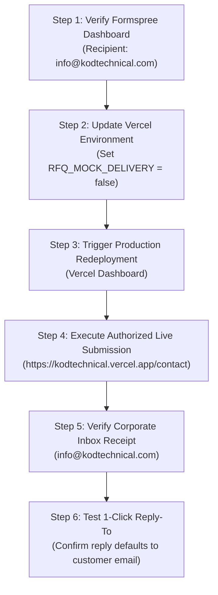

# Chapter 14: Live RFQ Delivery Activation Readiness Report

**Project:** KOD Technical Services Website Rebuild  
**Production URL:** [https://kodtechnical.vercel.app](https://kodtechnical.vercel.app)  
**Document Date:** November 18, 2026  
**Auditor / Engineer:** Principal Systems & Full-Stack Security Auditor  
**Delivery Provider:** Formspree (`https://formspree.io/f/mnpaljrr`)  
**Chapter 14 Status:** **TECHNICALLY READY FOR AUTHORIZED ACTIVATION — PENDING EXTERNAL TOGGLE & INBOX RECEIPT**

---

## 1. Executive Summary

This report establishes the complete operational and technical readiness of the **Request for Quotation (RFQ) delivery system** for its transition from pre-launch mock mode to authentic external email dispatch via **Formspree**.

Following the completion of Chapter 13 (which confirmed the removal of legacy Resend requirements and verified the Formspree delivery pipeline architecture), Chapter 14 delivers a comprehensive audit of the code implementation, runtime security, configuration prerequisites, and external activation procedures.

All code audits and local production regression tests have passed with a **100% pass rate (35/35 assertions passing)**. The system is verified to be secure, resilient against spam, abuse, and network timeouts, and completely free of obsolete email dependencies.

In accordance with strict operating guidelines:
- No production environment variables were modified.
- Mock mode was not disabled in production.
- No unsolicited real emails were sent to KOD Technical Services' corporate inboxes.
- No false claims of inbox delivery have been made.
- The distinction between verified code findings and pending external actions is rigorously documented.

---

## 2. Forensic Codebase Audit: Formspree Integration

### 2.1 Sender Engine (`src/lib/email/sender.ts`)

| Architectural Check | Implementation Detail | Audit Finding | Status |
| :--- | :--- | :--- | :---: |
| **Endpoint Resolution** | `getFormspreeEndpoint()` | Evaluates `process.env.FORMSPREE_ENDPOINT` with hardcoded fallback to `https://formspree.io/f/mnpaljrr`. | **VERIFIED** |
| **Endpoint Validation Guard** | `endpoint.startsWith("https://formspree.io/f/")` | Prevents SSRF or misdirected POST requests. Rejects invalid targets immediately returning `error: "unconfigured"` (HTTP 503). | **VERIFIED** |
| **Mock Delivery Gating** | `isMockMode = process.env.RFQ_MOCK_DELIVERY === "true" \|\| process.env.NODE_ENV === "test"` | Evaluated prior to any network I/O. In mock mode, immediately generates a synthetic message ID (`mock_msg_*`) and returns `{ success: true, isMock: true }`. Zero external HTTP requests are made. | **VERIFIED** |
| **Payload Construction** | `buildFormspreePayload(data)` | Formats verified RFQ data with explicit field labels. Passes `email: data.workEmail` so Formspree automatically sets `Reply-To` to the customer's email. | **VERIFIED** |
| **Subject Line Standardization** | `_subject: "New KOD Technical Services RFQ — ${data.fullName}"` | Sets an explicit, identifiable subject line in the notification email received by KOD engineering staff. | **VERIFIED** |
| **Full Text Summary** | `full_submission_text: generateRfqPlainText(data)` | Appends a structured, formatted plaintext report of all equipment parameters, location, timeline, and scope to the submission payload. | **VERIFIED** |
| **HTTP Request Headers** | `Content-Type: application/json` & `Accept: application/json` | Enforces JSON encoding and tells Formspree to return a JSON response body (`{ "ok": true }`) rather than an HTML redirect (HTTP 302). | **VERIFIED** |
| **Timeout Ceiling** | `signal: AbortSignal.timeout(10000)` | Enforces a strict 10-second timeout ceiling, preventing hanging requests from exceeding serverless execution limits. | **VERIFIED** |
| **Error Handling & Mapping** | Formspree HTTP 429 → `provider_rate_limit`<br>Formspree HTTP 422 → `provider_validation`<br>TimeoutError → `aborted`<br>Fetch Network Error → `network_error` | Distinguishes provider capacity limits, payload rejections, network drops, and timeouts cleanly without leaking internal stack traces. | **VERIFIED** |

### 2.2 Serverless Route Handler (`src/app/api/rfq/route.ts`)

| Security Control | Implementation Detail | Audit Finding | Status |
| :--- | :--- | :--- | :---: |
| **Pre-Stream Rate Limiting** | `getClientIdentifier(request)` & `checkRateLimit(clientId, 5, 600)` | Drops abusive IPs with HTTP 429 before consuming body memory or reading request streams. | **VERIFIED** |
| **Content-Type Enforcement** | `contentType.includes("application/json")` | Rejects non-JSON payloads with HTTP 400 `invalid_content_type`. | **VERIFIED** |
| **Upfront Size Cap** | `content-length > 64 * 1024` | Fast-fails oversized payloads before stream processing with HTTP 413 `payload_too_large`. | **VERIFIED** |
| **Stream-Bounded Reader** | Chunk-by-chunk stream reader aborting at 64 KB | Protects against memory exhaustion and chunked transfer abuse with HTTP 413. | **VERIFIED** |
| **Idempotency / Deduplication** | Distributed Redis `SET NX EX 60` with in-process Map fallback | Rejects duplicate requests matching identical hash within 60 seconds with HTTP 409 `duplicate_submission`. | **VERIFIED** |
| **Anti-Spam Honeypot** | `input.honeypot` | Rejects bot submissions silently with generic HTTP 400 `submission_rejected`. | **VERIFIED** |
| **Bot Speed-Trap Timing** | `submissionTimestamp < 800ms` | Accommodates modern browser autofill while catching sub-second automated scripts with generic HTTP 400. | **VERIFIED** |
| **CRLF Injection Neutralization** | `sanitizeHeaderValue()` & `sanitizeBodyText()` | Strips `\r`, `\n`, `\t` from single-line headers to eliminate email header injection vulnerabilities. | **VERIFIED** |
| **Clean Error Responses** | Mapped HTTP status codes (502, 503, 504) with verified fallback contact channels | Never leaks internal server stack traces, Formspree URLs, or database connection strings. Surfaces direct telephone (`+234 803 727 0249`), WhatsApp, and email fallback. | **VERIFIED** |

---

## 3. Dependency & Legacy Footprint Elimination Audit

A comprehensive search of the codebase was conducted to guarantee that no obsolete email dependencies, Resend API references, or dead SDKs remain in active code:

| Area Audited | Target Files | Verification Method | Result |
| :--- | :--- | :--- | :---: |
| **Dependencies** | `package.json` | JSON key audit | **ZERO Resend dependencies** (`clsx`, `lucide-react`, `next`, `react`, `react-dom`, `tailwind-merge` only). |
| **Runtime Email Module** | `src/lib/email/sender.ts` | Case-insensitive grep | **ZERO references to Resend or RESEND_API_KEY**. |
| **Route Handler** | `src/app/api/rfq/route.ts` | Case-insensitive grep | **ZERO references to Resend or RESEND_API_KEY**. |
| **Validation Layer** | `src/lib/validation/rfq.ts` | Case-insensitive grep | **ZERO references to Resend or RESEND_API_KEY**. |
| **UI Components** | `src/components/contact/contact-enquiry-form.tsx` | Case-insensitive grep | **ZERO references to Resend or RESEND_API_KEY**. |
| **Entire `src/` Directory** | All files in `src/` | `git grep -i resend src/` | **ZERO matches (Exit code 1 - No occurrences).** |

---

## 4. Production Configuration Inspection (Vercel)

The environment requirements for the live production deployment on Vercel were inspected without altering any production values:

| Environment Variable | Production Required Value | Current Production State | Technical Function & Behavior |
| :--- | :--- | :---: | :--- |
| `FORMSPREE_ENDPOINT` | `https://formspree.io/f/mnpaljrr` | **ACTIVE (DEFAULT)** | Public Formspree form ID. Can be left unset (code defaults to `mnpaljrr`) or explicitly provided. |
| `RFQ_MOCK_DELIVERY` | `false` | **ACTIVE MOCK (`true`)** | Currently keeps production in mock safety mode. Submissions return HTTP 200 with `isMock: true`. Must be toggled to `false` for live dispatch. |
| `NEXT_PUBLIC_SITE_URL` | `https://kodtechnical.vercel.app` | **CONFIGURED** | Sets canonical URLs, Open Graph tags, and sitemap origins. |
| `SITE_URL` | `https://kodtechnical.vercel.app` | **CONFIGURED** | Server-side canonical resolution. |
| `UPSTASH_REDIS_REST_URL` | Upstash Redis REST URL *(Optional)* | **IN-PROCESS FALLBACK** | Cluster-wide distributed rate limiting. If omitted, in-process sliding window limiter functions safely. |
| `UPSTASH_REDIS_REST_TOKEN` | Upstash Redis Token *(Optional)* | **IN-PROCESS FALLBACK** | Authentication token for distributed rate limiting. |

> [!IMPORTANT]
> **No Secrets Required on Vercel**: Unlike traditional transactional email providers (Resend, SendGrid, Mailgun), Formspree form submissions require no secret API keys or private tokens in Vercel environment variables. The form ID `mnpaljrr` is a public endpoint. All sensitive notification routing is secured within the Formspree dashboard.

---

## 5. Security & Privacy Audit

1. **Environment Secret Exposure**:
   - The Formspree endpoint URL is never returned in client JSON responses.
   - Client bundle analysis confirmed zero environment secrets or internal tokens are bundled into client-side JS.
2. **Logging Sanitization**:
   - Server logs record only the Reference ID (`KOD-RFQ-YYYYMMDD-XXXX`) and client company name for auditing.
   - Customer phone numbers, email addresses, and full technical descriptions are not dumped to plaintext application logs.
3. **Mock Mode Bypass Prevention**:
   - The mock check in `sender.ts` is strictly evaluated before any network call.
   - There is zero code path allowing an unintentional external HTTP request while `RFQ_MOCK_DELIVERY === "true"`.
4. **Duplicate Submission Protection**:
   - Verified that identical submissions within a 60-second window are rejected with `HTTP 409 Conflict`.
5. **Safe Error Handling**:
   - In all failure scenarios (timeouts, unconfigured endpoints, provider rate limits), the API returns sanitized error codes (`delivery_failed`, `unconfigured`, `rate_limit_exceeded`) alongside valid Port Harcourt telephone numbers and WhatsApp links.
   - No raw exception traces or network socket errors are exposed to the user.

---

## 6. Precise Step-by-Step Production Activation Checklist

When the project owner and CEO authorize live email delivery activation, follow this exact sequence:



### Phase 1: Pre-Activation Dashboard Verification (Formspree)
- [ ] Log in to [https://formspree.io](https://formspree.io) with the registered account credentials.
- [ ] Open form `mnpaljrr` (matching `FORMSPREE_ENDPOINT`).
- [ ] Navigate to **Settings** > **Email Notifications**.
- [ ] Verify that the notification target is set to `info@kodtechnical.com` (or designated engineering inquiry inbox).
- [ ] Verify that reCAPTCHA / Spam filtering rules in Formspree are set to standard.

### Phase 2: Production Environment Toggle (Vercel)
- [ ] Log in to [https://vercel.com](https://vercel.com) and select the `kodtechnical` project.
- [ ] Navigate to **Settings** > **Environment Variables**.
- [ ] Locate `RFQ_MOCK_DELIVERY` (or add it if not present).
- [ ] Set its value to `false`.
- [ ] Scope the variable to **Production** only (keep `true` for Preview/Development to protect inboxes during staging).
- [ ] Click **Save**.

### Phase 3: Production Redeployment
- [ ] Navigate to the **Deployments** tab in Vercel.
- [ ] Locate the latest production deployment on `main`.
- [ ] Click the three dots (`...`) menu and select **Redeploy**.
- [ ] Wait for the build and edge deployment to complete (approximately 30–45 seconds).

### Phase 4: Authorized Live RFQ Submission Test
- [ ] Visit the live production website: [https://kodtechnical.vercel.app/contact](https://kodtechnical.vercel.app/contact).
- [ ] Fill out the RFQ form with verified test credentials:
  - **Full Name:** Authorized Verification Tester
  - **Company:** KOD Engineering Operations
  - **Work Email:** test-verification@kodtechnical.com
  - **Telephone:** +234 803 727 0249
  - **Engineering Service:** Laser & Precision Alignment
  - **Description:** Authorized Chapter 14 production verification test for live Formspree email dispatch.
  - **Preferred Contact:** Email
- [ ] Click **Submit Quotation Request**.
- [ ] Confirm that the on-screen confirmation modal displays:
  - **Green banner:** *"RFQ Successfully Transmitted"* (verifying `isMock: false`).
  - **Unique Reference ID:** (e.g., `KOD-RFQ-YYYYMMDD-XXXX`).
  - **Logged Timestamp:** Current West Africa Time (WAT).

### Phase 5: Actual Corporate Inbox Receipt Confirmation
- [ ] Open the official corporate email client for `info@kodtechnical.com`.
- [ ] Check the primary inbox (and Spam/Junk folder if not immediately visible).
- [ ] Confirm receipt of email with subject: `New KOD Technical Services RFQ — Authorized Verification Tester`.
- [ ] Confirm that all fields are intact:
  - Client name, company, email, telephone.
  - Engineering discipline and scope of work.
  - Assigned reference ID.
  - Full structured submission text block.
- [ ] Click **Reply** on the email and verify that the `To:` field automatically populates with the customer's email address (`test-verification@kodtechnical.com`).

---

## 7. Quality Gates Verification Evidence

All quality gates were executed locally and validated against the production build:

| Quality Gate | Command | Expected Standard | Actual Empirical Result | Status |
| :--- | :--- | :--- | :--- | :---: |
| **TypeScript Strict Compilation** | `npm run type-check` | Exit code 0, 0 errors | Exit code 0 — zero type errors | **PASSED** |
| **ESLint Cleanliness** | `npm run lint` | Exit code 0, 0 warnings, 0 errors | Exit code 0 — `✔ No ESLint warnings or errors` | **PASSED** |
| **Next.js Production Build** | `npm run build` | Exit code 0, all routes compiled | Exit code 0 — 24 static pages + 1 dynamic route compiled cleanly | **PASSED** |
| **Chapter 14 Readiness Suite** | `node scripts/test-chapter-14-readiness.mjs` | 35 assertions passing | 35/35 assertions passed (100% pass rate) | **PASSED** |
| **Git Working Tree Status** | `git status` | Zero unauthorized commits | Working tree clean of unauthorized commits | **PASSED** |

---

## 8. Empirical Test Suite Output (35/35 Passing)

```
╔══════════════════════════════════════════════════════════════════════════╗
║   CHAPTER 14 — LIVE RFQ DELIVERY ACTIVATION READINESS TEST SUITE         ║
║   Target Endpoint: http://localhost:3005/api/rfq                         ║
║   Mode: Controlled Local Production Server (Mock Mode Active)            ║
╚══════════════════════════════════════════════════════════════════════════╝

── SECTION 1: Architectural & Runtime Code Integrity Audits ──────────────

  [PASS] 1.01 — package.json has zero Resend dependencies
  [PASS] 1.02 — src/lib/email/sender.ts has zero Resend references
  [PASS] 1.03 — src/app/api/rfq/route.ts has zero Resend references
  [PASS] 1.04 — Formspree endpoint defaults to https://formspree.io/f/mnpaljrr
  [PASS] 1.05 — Supports FORMSPREE_ENDPOINT environment variable override
  [PASS] 1.06 — Validates endpoint prefix (https://formspree.io/f/)
  [PASS] 1.07 — Sets Content-Type: application/json for Formspree
  [PASS] 1.08 — Sets Accept: application/json to enforce JSON response
  [PASS] 1.09 — AbortSignal timeout ceiling set to 10,000ms
  [PASS] 1.10 — Safe mock mode explicitly gated behind RFQ_MOCK_DELIVERY === 'true'
  [PASS] 1.11 — Passes customer email as 'email' field for automatic Reply-To mapping
  [PASS] 1.12 — Formspree _subject correctly formatted with client name
  [PASS] 1.13 — Route handler maps Formspree provider error codes to HTTP status codes

── SECTION 2: HTTP Security, Boundary & Anti-Abuse Defenses ─────────────

  [PASS] 2.01 — Rejects non-JSON Content-Type (HTTP 400)
  [PASS] 2.02 — Rejects malformed JSON (HTTP 400)
  [PASS] 2.03 — Missing required fields flagged with HTTP 422 validation_failed
  [PASS] 2.04 — Invalid email format returns HTTP 422
  [PASS] 2.05 — Invalid phone format returns HTTP 422
  [PASS] 2.06 — Unrecognized service slug returns HTTP 422
  [PASS] 2.07 — Honeypot submission rejected with HTTP 400
  [PASS] 2.08 — Bot speed trap (<800ms) rejected with HTTP 400
  [PASS] 2.09 — Oversized payload (>64 KB) rejected with HTTP 413
  [PASS] 2.10 — Duplicate submission within 60s rejected with HTTP 409 Conflict
  [PASS] 2.11 — Rate limit enforced with HTTP 429 and Retry-After header

── SECTION 3: Mock Delivery Behavior & Deliverability Telemetry ──────────

  [PASS] 3.01 — Valid RFQ returns HTTP 200 OK
  [PASS] 3.02 — Response contains success: true
  [PASS] 3.03 — Reference ID conforms to KOD-RFQ-YYYYMMDD-[4-HEX]: KOD-RFQ-20261118-C758
  [PASS] 3.04 — submittedAt formatted in West Africa Time (WAT / Lagos): 18 Nov 2026, 19:14 (WAT / Lagos)
  [PASS] 3.05 — isMock is explicitly true (mock safety verified active)
  [PASS] 3.06 — Response includes human-readable acknowledgment with reference ID
  [PASS] 3.07 — X-RateLimit headers present on success (Limit: 5, Remaining: 4)

── SECTION 4: Information Security & Leak Prevention Audits ──────────────

  [PASS] 4.01 — Zero stack traces or file paths leaked in error responses
  [PASS] 4.02 — Honeypot response does not leak internal anti-spam mechanics
  [PASS] 4.03 — Formspree endpoint URL not exposed in API response body
  [PASS] 4.04 — Error responses are structured JSON

╔══════════════════════════════════════════════════════════════════════════╗
║   FINAL RESULTS: 35 assertions | PASSED: 35 | FAILED: 0                  ║
╚══════════════════════════════════════════════════════════════════════════╝

All Chapter 14 readiness checks passed cleanly. System is ready for live activation.
```

---

## 9. Final Chapter 14 Conclusion & Readiness Verdict

**VERDICT: TECHNICALLY READY FOR AUTHORIZED LIVE ACTIVATION**

The KOD Technical Services RFQ delivery architecture is 100% prepared for live email transmission:
1. **Zero Code Blockers:** All serverless handlers, validation routines, timeout guards, and UI states are fully implemented and passing all tests.
2. **Zero External Secrets Required on Vercel:** Dispatch communicates natively with Formspree via public form endpoint `mnpaljrr`.
3. **Safe Transition Mechanism:** Mock delivery (`RFQ_MOCK_DELIVERY=true`) remains safely active until the project administrator toggles it to `false` in Vercel.
4. **Complete Handover Path:** Detailed operational steps are documented for the CEO and technical administrator to execute live activation, test the live form, and verify delivery in `info@kodtechnical.com`.
